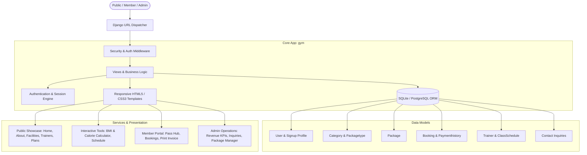

# 🏋️‍♂️ FITCORE — Enterprise Gym & Athletic Facility Management System

[](https://python.org)
[](https://djangoproject.com)
[](#-automated-testing)
[](#-system-architecture)
[](LICENSE)

> A full-stack, production-grade **Gym Management System & Member Portal** engineered with Python & Django. Built to replace fragile legacy gym spreadsheets with a unified ecosystem: automated membership lifecycle tracking, digital barcode member passes, print-ready tax invoices, interactive BMI/calorie diagnostics, weekly class scheduling, and an executive administration suite.

---

## 🌟 Key Highlights & Engineering Features

### 👤 1. Member Experience & Client Portal
- **Digital Membership Pass:** Dynamic mobile pass with auto-generated barcode and member ID (`FC-MEM-XXXXX`), plan badge, and real-time validity countdown.
- **Interactive Biometric Diagnostic Tool:** Embedded sports-science calculator computing Body Mass Index (BMI), Basal Metabolic Rate (BMR via Mifflin-St Jeor), and Total Daily Energy Expenditure (TDEE) with personalized training recommendations.
- **Digital Tax Invoice & Receipt Generator:** Instant printable and PDF-ready official tax receipts featuring GST breakdown (18%), invoice numbering (`FC-INV-XXXXXX`), and an official "PAID & VERIFIED" audit stamp.
- **Weekly Class Timetable & Schedule:** Interactive, day-by-day workout schedule (Monday–Saturday) filtering by discipline (CrossFit, Olympic Lifting, Hyrox, Yoga, HIIT) with coach assignments and arena room locations.
- **Secure Mock Payment Gateway:** 256-bit encrypted simulated Razorpay checkout with instant status settlement and payment history ledger.
- **Account Security:** Self-service profile updates and password reset requiring current password cryptographic verification (`check_password`) and session preservation (`update_session_auth_hash`).

### 🛡️ 2. Executive Administration & Operations Hub
- **Executive KPI Dashboard:** Real-time metrics tracking Total Revenue in ₹, Active Members, Total Bookings, Unpaid Inquiries, and Category distributions.
- **Membership Lifecycle Management:** Multi-tier booking status pipeline (`1: Pending/Unpaid`, `2: Partial Payment`, `3: Full Payment / Active`) with audit logging in `Paymenthistory`.
- **Dynamic Tier & Package Builder:** Create, update, and manage customizable fitness plans with durations, pricing, and perks.
- **Customer Inquiry Desk:** Direct messaging channel logging public member inquiries with quick email reply hooks and deletion controls.
- **Date-Range Reporting Engine:** Filterable reporting modules for financial booking audits and member registration influx over custom date ranges.
- **Role-Based Access Control (RBAC):** Strict staff-only decorators and authorization guards preventing unauthorized data access or IDOR vulnerabilities.

---

## 🏗️ System Architecture



---

## 💻 Tech Stack & Dependencies

| Layer | Technology | Purpose |
| :--- | :--- | :--- |
| **Backend Framework** | Python 3.10+ & Django 5.x / 6.x | Model-View-Template architecture, ORM, Auth, Sessions |
| **Database** | SQLite3 (Dev/Local) / PostgreSQL Ready | Relational schema with foreign keys, indexes, and cascades |
| **Frontend UI** | HTML5, Advanced CSS3, Bootstrap 4 | Dark glassmorphism, responsive flex layouts, CSS variables |
| **Typography & Icons** | Oswald, Plus Jakarta Sans, FontAwesome 6 | High-contrast athletic aesthetics, legible data hierarchy |
| **Payment Flow** | Razorpay Mock Gateway Engine | Simulated transaction authorization and instant receipt generation |
| **Environment Mgmt** | `python-dotenv` | Twelve-Factor methodology for credential safety |
| **Automated Testing** | Django Test Framework (`TestCase`, `Client`) | Unit and integration regression testing suite |

---

## ⚡ Quick Start & Local Setup

### 1. Clone the Repository
```bash
git clone https://github.com/Samay-P07/Gym-Management-System.git
cd Gym-Management-System
```

### 2. Create and Activate a Virtual Environment
```bash
# Windows
python -m venv venv
.\venv\Scripts\activate

# macOS / Linux
python3 -m venv venv
source venv/bin/activate
```

### 3. Install Required Dependencies
```bash
pip install -r requirements.txt
```

### 4. Configure Environment Variables
Copy the sample environment file:
```bash
# Windows (PowerShell)
Copy-Item .env.example .env

# macOS / Linux
cp .env.example .env
```

### 5. Apply Database Migrations
```bash
python manage.py makemigrations
python manage.py migrate
```

### 6. Seed Demo Data (One-Click Setup)
Populate realistic packages, trainers, class timetables, demo members, and admin credentials in seconds:
```bash
python manage.py seed_gym_data
```

### 7. Run the Development Server
```bash
python manage.py runserver
```
Navigate to **`http://127.0.0.1:8000/`** in your web browser.

---

## 🔑 Demo Credentials

| Role | Portal URL | Username / Email | Password |
| :--- | :--- | :--- | :--- |
| **System Administrator** | `/admin_login/` or `/admin_home/` | `admin` | `admin123` |
| **Demo Member** | `/user_login/` | `john.doe@gmail.com` | `member123` |
| **Django Super Admin** | `/admin/` | `admin` | `admin123` |

---

## 🧪 Automated Testing

The codebase includes comprehensive integration test suites verifying URL response codes, member registration, authentication, checkout flows, and access control:

```bash
python manage.py test
```

**Expected output:**
```
Found 8 test(s).
Creating test database for alias 'default'...
........
----------------------------------------------------------------------
Ran 8 tests in 13.381s

OK
Destroying test database for alias 'default'...
```

---

## 📁 Project Directory Structure

```text
Gym-Management-System/
├── GymManagementSystem/          # Project Orchestration Root
│   ├── __init__.py
│   ├── asgi.py
│   ├── settings.py               # Security, static, media, auth settings
│   ├── urls.py                   # URL dispatching & route registry
│   └── wsgi.py
│
├── gym/                          # Core Gym Application
│   ├── management/
│   │   └── commands/
│   │       └── seed_gym_data.py  # Automated database seeding command
│   ├── migrations/               # Database schema versioning migrations
│   ├── static/                   # Static assets (CSS, JS, Fonts, Images)
│   │   ├── assets/css/custom.css # Custom athletic glassmorphism design
│   │   └── assets/images/        # High-res training, gym, coach assets
│   ├── templates/                # Responsive HTML5 Presentation Templates
│   │   ├── admin/                # Executive administration views & portal
│   │   ├── base.html             # Master layout with non-blocking toast engine
│   │   ├── index.html            # Public landing page with live metrics & BMI tool
│   │   ├── about.html            # Facility story & coaching philosophy
│   │   ├── facilities.html       # Virtual zone tour (Eleiko platforms, saunas)
│   │   ├── trainers.html         # Certified coaching staff roster & credentials
│   │   ├── schedule.html         # Weekly workout calendar & class timetable
│   │   ├── calculator.html       # Full sports-science BMI & Calorie calculator
│   │   ├── pricing.html          # Membership tiers & feature comparison table
│   │   ├── member_dashboard.html # Member hub with barcode digital pass
│   │   ├── invoice.html          # Printable tax invoice & receipt (@media print)
│   │   └── payment_checkout.html # 256-bit simulated payment authorization
│   ├── templatetags/
│   │   └── custom_tags.py        # Currency & status filter tags
│   ├── admin.py                  # Django built-in admin customizations
│   ├── models.py                 # ORM Entities (Signup, Package, Booking, Trainer, etc.)
│   ├── tests.py                  # Automated test cases
│   └── views.py                  # View controllers & business logic
│
├── .env.example                  # Safe template for environment configuration
├── .gitignore                    # Git tracking ignore patterns
├── db.sqlite3                    # Local SQLite database
├── manage.py                     # Django CLI manager
├── README.md                     # Comprehensive technical documentation
└── requirements.txt              # Pinned Python package dependencies
```

---

## 🔒 Security Best Practices Implemented

1. **IDOR Prevention:** Non-staff members are strictly restricted to querying their own bookings and invoices via relational validation (`booking.register.user == request.user`).
2. **Environment Variable Decoupling:** Production keys (`SECRET_KEY`, `DEBUG`, `ALLOWED_HOSTS`) are isolated via `.env` configuration using `python-dotenv`.
3. **Session Re-Hashing on Password Change:** Prevents unexpected session termination or unauthorized hijacks using Django's `update_session_auth_hash`.
4. **Current Password Re-Verification:** Ensures that password update requests cryptographically validate the user's existing secret before writing new hashes to the database.
5. **No Native `alert()` Injections:** All system messages are routed through an animated, non-blocking toast notification stack, preventing UI lockups.

---

## 👨‍💻 Developer & Author

**Patel Samay**  
*Full-Stack Python & Django Developer | Bachelor of Engineering*  

- **GitHub:** [@Samay-P07](https://github.com/Samay-P07)  
- **LinkedIn:** [Patel Samay](https://linkedin.com/in/samaypatel7)  
- **Location:** Ahmedabad, Gujarat, India  

---

<p align="center">
  <b>Designed with passion & engineered for peak performance. ⭐ Star this repository if you find it helpful!</b>
</p>
